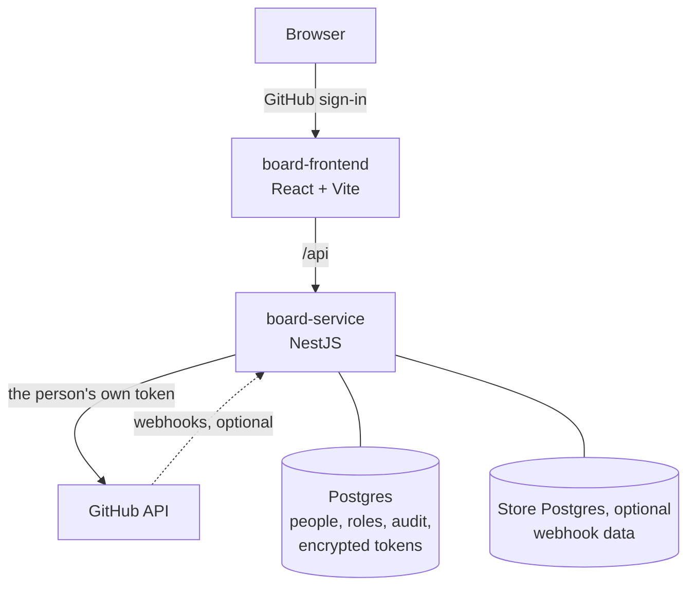

# github-board

A board for GitHub issues, Projects (v2) boards and delivery activity across one or more GitHub organisations. People sign in with GitHub, and each person sees only what GitHub lets them see.

## Why it exists

GitHub spreads one team's work over many pages: issues per repository, Projects boards per organisation, pull requests and releases per repository. This board puts them on one screen. A supported edit, such as a label, an assignee or a Projects field, goes back to GitHub. GitHub stays the source of truth.

The board does not keep its own copy of the work, and it adds no permission system of its own. Every read for a signed-in person uses that person's own GitHub token. So a private repository or a private Projects board stays private: the board shows it only to the people that GitHub lets read it.

## The design



| Choice | Reason |
| --- | --- |
| GitHub sign-in only | GitHub already holds the accounts, the organisations and the permissions. A second identity provider adds nothing. |
| Reads with the person's token, never a shared token | A person can never see a repository through the board that GitHub hides from them. |
| `BOARD_ALLOWED_GITHUB` decides who can sign in | One setting makes an instance private to some people or organisations. Empty lets any GitHub user sign in. |
| Writes are off by default | Writes use one shared machine credential. They need the Postgres audit trail, which records who pressed the button. |
| Two databases | GitHub data in the store database can be rebuilt at any time. The main database holds the encrypted tokens and must not mix with it. The service refuses to start when both URLs point at the same database. |

## What's where

| Path | What it holds |
| --- | --- |
| `board-frontend/` | The React app, its API adapters and the browser checks |
| `board-service/` | The NestJS API, the GitHub sources, the MCP server and the Prisma stores |
| `deploy/` | The service image and the Caddy configuration. The frontend `Dockerfile` is at the root. |
| `docs/` | Self-hosting documents |
| `scripts/` | The shared test harness |

The frontend and the service are separate packages with separate lockfiles. Run each command inside its package.

## Run it

You need Node.js 22 and pnpm 10.34.3.

The example settings use fixture data. They need no GitHub credentials and no database, and they turn sign-in off for local use.

```sh
cd board-service
pnpm install --frozen-lockfile
cp .env.example .env
pnpm db:generate
pnpm start:dev
```

In a second terminal:

```sh
cd board-frontend
pnpm install --frozen-lockfile
BOARD_API_PORT=3000 pnpm dev
```

Open http://localhost:5173.

To read real GitHub data and to sign in with GitHub, follow [docs/self-hosting.md](docs/self-hosting.md).

### Check a change

```sh
cd board-service && pnpm test && pnpm typecheck && pnpm build
cd board-frontend && pnpm build && pnpm test
```

Build the frontend before its tests, because some checks run the built files in a headless browser. If the browser is outside the usual places, set `CHROME_PATH`. The database tests run with `pnpm run test:db` in `board-service/` and need `DATABASE_URL`.

[CONTRIBUTING.md](CONTRIBUTING.md) has the full process.

## License

[MIT](LICENSE)
